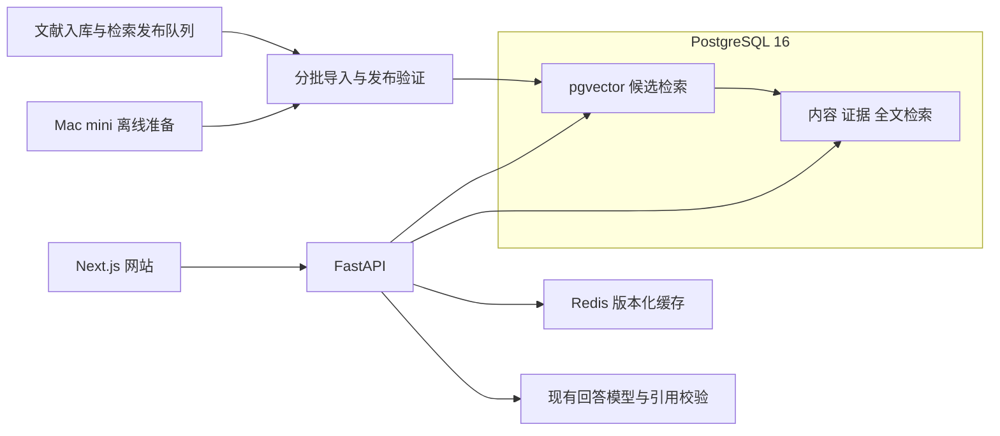

# SCLib pgvector 网站迭代计划

日期：2026-11-02。方案选择：PostgreSQL 与 pgvector。当前阶段：已启动实施。旧 Google 部署已取消；pgvector 生产迁移、流量切换及当前 Google 部署取消均未执行。实际状态见 [实施记录](operations/PGVECTOR_EXECUTION_20261102.md)，以下门槛继续有效。

本次迭代将全文搜索、语义搜索和相似论文检索整合到 VPS 的 PostgreSQL，保留网站内容、API、问答引用和科学数据解释，最终取消两套 Google Vector Search 在线部署。先处理已闲置的旧部署，再在本地替代方案验收后处理当前生产部署。具体操作、资源标识和中断恢复见 [Google 索引托管下架方案](operations/GOOGLE_VECTOR_SEARCH_RETIREMENT.md)。

完成标准包括正常读写、数据完整、检索质量、恢复能力和托管费用停止增长。页面能打开、请求返回 200 或向量总数一致，都不能单独证明完成。

## 现网基线

以下为 2026-11-02 只读核查结果。正式执行前重新采集，发现变化即重算迁移输入和恢复方案。

| 项目 | 已核查值 |
| --- | --- |
| 生产网站与 API revision | `984d5d96f7bc5a8727fab20579e4016f740bef42` |
| 保留基线 API revision | `1f9dc6cdd834ce146c231991c42fd01b2d5e9c19`，同样使用当前新 Google 索引 |
| VPS | `jzis-vps2`，`srv1554116`，IPv4 `72.62.251.29` |
| PostgreSQL | `16.13`，Alpine musl，x86_64，数据库 `sclib` |
| PostgreSQL 当前镜像 ID | `sha256:20edbde7749f822887a1a022ad526fde0a47d6b2be9a8364433605cf65099416` |
| 实际数据库 schema head | `0106_materials_source_notation` |
| 当前 pgvector 状态 | 镜像中没有可用的 `vector` 扩展，不能仅运行 `CREATE EXTENSION` |
| VPS 资源 | 8 核，31.34 GiB 总内存，约 232.75 GiB 空闲磁盘 |
| 数据库体积 | 约 22.48 GiB，含正文、证据、历史回执及现有搜索表 |
| 当前内容 generation | `5e76b262-3c7f-41ee-a3c2-9034ce4f3053` |
| 当前 activation event | `7adbbc2d-d60f-5cb1-8ea2-6efce3e1e272` |
| 已保留向量 | 1,183,943 条，均为 3,072 字节，共 3,637,072,896 字节，约 3.39 GiB |
| embedding 配置 | `text-embedding-005`，768 维，文档与查询任务类型分别保留 |

向量条数和长度已核查；迁移时仍须逐条核对实际向量及正文摘要。既有现场记录在仓库外 `SCWiki/reports/vector-billing-audit-20261102/`。本轮进一步核对的生产 schema 和镜像不能用旧 checkout 的状态替代。

当前工作目录 HEAD 为 `cbc8f16`，包含大量其他任务的未提交修改。开发从重新核实的 `origin/main` 创建独立分支或 worktree；逐项比较其与生产 revision 的差异，不把当前目录直接作为发布源。新增迁移编号在确认最新 Alembic 图后分配，不预先占用 `0107`。

## 范围和网站功能

| 功能 | 本次处理 | 验收要求 |
| --- | --- | --- |
| 首页文献搜索及原 `/search` 入口 | 替换向量候选后端，保留全文检索、排序、分页和旧入口跳转 | 关键词、描述性问题、中英文输入、公式、年份等查询继续工作 |
| AI 问答 | 替换检索候选来源，沿用当前回答模型、上下文预算及引用校验 | 每个引用仍能解析到相应来源版本；无证据时按原契约说明 |
| 相似论文 | 用 pgvector 复用文档向量，保留当前论文去重和来源过滤 | 返回真实关联论文，余弦分数含义一致，排除自身及受限记录 |
| 论文详情 | 继续读取 PostgreSQL，单独验证相似推荐子请求 | 正文信息、摘要、DOI、作者及来源链接完整 |
| Materials 及新版 NER 数据 | 保留现有读写路径、审核边界和下载功能 | 材料记录、条件、证据和导出内容不被搜索迁移重写 |
| Tc 时间线 | 保留当前投影和读取政策 | 相同过滤下的完整数据摘要与 CSV 内容一致 |
| SCWiki | 保留静态内容、搜索文件及独立排序 | 文章、引用、锚点、搜索和旧链接可用 |
| Discovery 和研究工作台 | 保留当前权限与业务服务 | 页面、授权操作、历史结果和下载通过回归 |
| 用户功能 | 保留登录、配额、收藏、历史记录和反馈 | 身份与可见性不变；历史问答的旧版本引用仍可读取 |
| 文献入库 | 替换发布目标，建立可续跑的检索发布队列 | 新增、修订、撤稿、撤权和失败重试均有真实回执 |
| 监控和恢复 | 增加 pgvector、发布队列及后端版本指标 | 能检测降级，能恢复，无隐式 Google 回退 |

本次保留 embedding 模型，避免同时更换模型空间和检索引擎。Google 的 embedding、Gemini、GCS 及备份若仍被使用，继续按既有配置运行；本次退出的是 Matching Engine 索引托管。NER 使用既定独立流程，不因索引迁移重新抽取全部论文，不改其 key 和预算归属。

## 目标架构

PostgreSQL 仍是内容、证据、权限和检索成员清单的权威。pgvector 表属于可验证、可重建的检索投影，不另存一份论文全文。数据库只在内网提供服务，不新增公网数据库端口。

首版使用 `vector(768)` 与 HNSW 余弦索引，保留 float32 原值，不引入量化或半精度。以完整精确检索样本作为 ANN 的质量参照。`m=16`、`ef_construction=64` 仅作为压测起点，最终参数随构建版本封存。pgvector 的过滤会影响 ANN 召回，需结合候选扩展、迭代扫描和小候选集精确计算验证，不能只保证 SQL 语法可执行。[pgvector 索引和过滤文档](https://github.com/pgvector/pgvector#filtering)

## 数据版本和后端契约

### 保留既有历史

现有 `index_generations`、成员、激活事件和 manifest 是不可变历史，其中资源字段绑定了 Vertex。现有验证器也只接受 `vertex-public` 或测试后端。不得修改这些历史行的资源字段、覆盖 manifest，或伪装成测试后端绕过校验。

新增 v2 检索契约，将内容版本与提供查询的后端构建分开：

| 新增对象概念 | 作用 |
| --- | --- |
| 内容版本与成员引用 | 首个版本引用现有 generation 和成员摘要；以后支持已保留旧片段与新原生片段，保持解析及证据来源区别 |
| 后端构建记录 | 绑定内容版本、embedding profile、pgvector 版本、距离规则、参数、实现 revision 和成员 manifest |
| 向量投影表 | 保存构建 ID、原成员 ID、论文 ID、向量、向量与正文摘要及必要过滤字段，引用权威内容，不复制全文 |
| 验证回执 | 记录完整枚举、逐条读回、摘要核对、差异、质量评测和实际观察时间 |
| 激活事件及当前指针 | 同时绑定内容版本和后端构建，比较准确前序事件后原子激活；回退也追加事件 |

表名与 revision 在实施 PR 中冻结。v2 使用独立版本化表和验证规则，v1 历史继续按原规则验证。旧 generation 的兼容读取不要求 Google 服务在线。

未来新增论文不能继续创建虚假的 Vertex 资源记录。v2 内容版本必须能引用新的原生片段、完整输入回执和真实 embedding 回执；不同来源的科学抽取父记录缺失状态仍如实保留。上线前必须实测一次完整的新论文发布和一次更正发布，而非只迁移静态的旧 generation。

### 查询一致性

每个 Search、Ask、Similar 请求固定同一份内容与后端版本。候选 ID、向量摘要和片段摘要通过核对后，才从 PostgreSQL 装载正文；回答发布前重新检查当前版本及来源状态。缓存键包含内容版本、激活事件、后端构建及相关可见性版本。

实施时明确后端选择、shadow/canary/primary 模式、灰度比例、Google 临时 fallback 开关、检索并发与连接预算、SQL 超时和构建任务预算。配置名在实现 PR 中冻结；模式、目标或参数缺失时不回落到 `sclib_papers_v1` 默认值。活动构建由数据库已验证指针选择，配置和缓存不能覆盖该权威。

保留旧版问答和收藏的成员 ID。新读协议若增加后端身份字段，要同步 API、前端校验和历史回放，保留现有公开字段含义。后端名称与构建参数只进入内部运维信息，不加入普通网站流程。

不能删除现有 active pointer 以强行触发 legacy fallback。当前科学条件查询依赖有效 generation；清空指针会改变其可用性，并让部分检索退回可变旧片段。

### 发布方式

首版使用当前构建和前一构建两套本地投影，实现原子切换与本地回退；按构建隔离 HNSW 索引，避免两个版本互相占用候选。索引参数和确切表名由经过验证的构建清单选择，不接收用户提供的 SQL 对象名。

新论文先提交权威内容及待发布事件，再按显式批次合并、构建和激活。只为新增或变化的片段生成 embedding，历史向量复用；构建新投影仍有物理复制和建索引成本，要计入资源预算。首版不为每篇论文重建百万条索引，活动采集时按日或经压测确定的批次发布，目标检索新鲜度不超过 24 小时。后续若蓝绿重建成为瓶颈，再单独设计共享向量存储和分段压缩。

撤稿或权限撤销立即影响读侧过滤，不等待下一次索引发布。历史内容的许可和科学状态不因回退而恢复。

## PostgreSQL 镜像和恢复准备

在与生产相同的 PostgreSQL 16.13、Alpine musl、x86_64 基础上制作固定版本的 pgvector 镜像，固定依赖与镜像摘要。扩展版本以隔离副本完整测试通过的稳定版本为准，禁止生产临时拉取 `latest` 或顺带升级 PostgreSQL 大版本。

1. 取得生产备份，并在独立实例恢复到明确的备份位置或 WAL 截止点；核对关键数据与应用读取。
2. 在恢复副本测试扩展安装、DDL、百万条构建、查询、重启、备份与恢复。
3. 准备与新 schema 精确匹配的 API、migration、ingestion 和基线镜像。当前 schema admission 要求 exact head，旧镜像在 schema 升级后重启可能被拒绝。
4. 使用项目现有一次性 migration 服务和专用凭据执行未来生产 DDL，沿用迁移锁；API 不自动执行迁移，不通过 API 账号授予自己 DDL 权限。
5. 当前单主数据库的镜像切换安排一个经过演练计时的短维护窗口，提前停止接收新请求、排空连接并按恢复顺序启动。目标窗口不超过 5 分钟，超过则停止并使用已验证恢复路径；此目标尚待演练，不承诺零中断。

创建 vector 类型数据后，数据库回退镜像也必须包含兼容 pgvector 库。不能只把旧 `postgres:16-alpine` 镜像切回来，也不执行 `DROP EXTENSION ... CASCADE`。优先回退应用或激活前一构建，保留新增 schema；灾难恢复才使用独立恢复实例及 WAL，不能用旧整库覆盖上线后新增用户数据。

2026-11-02 磁盘清理后的只读检查已实际发现：保留的 `sclib-site-baseline-api` 因镜像要求的 schema 与数据库不一致而循环重启，累计超过 22,000 次；当前生产 API healthy、重启计数为零。旧基线不能作为已验证可用的应用回退入口。P2/P6 必须交付并实测兼容基线和回退镜像，本次磁盘清理没有修改该容器或放宽 schema admission。

备份按 [项目灾难恢复流程](DISASTER_RECOVERY.md) 和 [PostgreSQL 官方备份分类](https://www.postgresql.org/docs/16/backup.html) 执行。把“备份命令成功”与“恢复并读取成功”分别留证。

沿用现有灾难恢复目标：RPO 不超过 24 小时、RTO 不超过 4 小时、至少 35 个每日恢复点。这些是既定目标，实际演练记录观测值；本次没有核实连续 WAL 归档，因此不承诺灾难情况下零数据损失。正常应用/构建回退不还原旧整库，保留切换后写入；灾难恢复另按实际恢复点与可用日志报告数据缺口，不能混同两类恢复。

## 资源预算

3.39 GiB 仅是已有向量原值，不含投影行、HNSW、WAL、临时文件、第二构建和备份。实际峰值在完整副本上测量后冻结。

| 资源 | 初始安排 | 执行门槛 |
| --- | --- | --- |
| 索引构建 | 单任务、最多 2 个并行维护 worker，初始构建内存预算 4 GiB | 同时观察整机和容器 RSS、连接、I/O 与公开 API 延迟；不能将单参数当整机内存上限 |
| 连接与查询 | 单独限制检索并发和连接池；查询设置本地超时，离开事务不遗留参数 | 写入、登录和普通页面读取不能被 ANN 饱和拖垮 |
| 本地版本 | 活动构建和前一可回退构建 | 第二构建及未完成构建都进入容量统计 |
| 磁盘底线 | 延续 VPS 80 GiB 最低空闲量 | 导入、WAL、建索引和备份前后均检查；不足暂停，不清理用户数据 |
| APS 配额 | 延续 APS 项目总占用 128 GiB 上限 | 与本次索引占用共同预算，不分别承诺可用空间 |
| 离线产物和备份 | 大部分导出、评测与备份放 Mac mini 或既有异机备份位置 | 原文按原许可与保留政策处理，不增加永久全文副本 |

清理前空闲约 232.75 GiB，扣除 APS 最大配额和 80 GiB 底线，余量约 24.75 GiB。经用户确认的 [第一轮磁盘清理](operations/VPS_DISK_CLEANUP_PLAN_20261102.md) 已于 2026-11-02 完成，实际空闲提高到 **262.02 GiB**，同口径新增索引及其他增长余量约 **54.02 GiB**。完整构建峰值若超过余量，先扩容存储或调整实际 APS 批次预算并取得明确取舍，不能挤占底线。当前 PostgreSQL/API 容器无硬内存限制；实施时根据实测设置整体预算，避免盲目限额导致 OOM。

## 迭代和交付顺序

| 阶段 | 工作与交付 | 进入下一阶段的条件 | 估算工程工作量 |
| --- | --- | --- | --- |
| P0 基线冻结 | 记录代码、镜像、schema、索引配置、消费者、数据 manifest、性能、备份和预算 | 输入及恢复清单一致；源码基线明确 | 0.5 至 1 日 |
| P1 闲置索引退役 | 补齐旧索引查询及更新依赖核查，按下架方案取消 `sclib_papers_v1` 部署 | 操作完成、旧部署缺失、当前网站全链路仍工作 | 约 0.5 日，可与开发准备交错 |
| P2 数据库运行环境 | 制作 pgvector 镜像，在恢复副本演练扩展、DDL、恢复及维护窗口 | 原有业务读取与完整恢复通过 | 1 至 2 日 |
| P3 检索契约和适配 | 实现 v2 内容与后端绑定、SQL adapter、API 一致性、缓存、前端与历史兼容 | 数据、权限、版本切换及失败行为测试通过 | 2 至 3 日 |
| P4 数据和增量流程 | 续跑导入、完整构建、逐条读回；入库队列、修订及撤权流程 | 全部声明成员无缺失/额外/摘要差异；真实增量回放通过 | 1 至 2 日，另计机器运行时间 |
| P5 对照评测 | 固定查询集、精确 ANN 参照、引用评审、全站回归及压力测试 | 满足下述验收门槛，失败项不跳过 | 1 至 2 日 |
| P6 生产切换 | 显式 schema 迁移、维护窗口、灰度、更新基线与回退镜像 | 全流量 pgvector，基线与所有 writer 同步，Google fallback 关闭 | 0.5 至 1 日及灰度观察 |
| P7 稳定和新索引退役 | 全流量至少 7 个完整日稳定，演练本地回退和恢复，再取消当前 Google 部署 | 生产及恢复路径均不依赖 Google ANN | 至少 7 日观察，工程工作约 0.5 日 |
| P8 费用和收尾 | 验证 serving 停止累计、配置与调用清零，交付维护及恢复记录 | 费用证据齐全；永久删除阶段单列 | 0.5 日，另计账单延迟 |

总工程工作量约 **8 至 12 个工作日**，另含全量机器运行及至少 7 日全流量稳定观察。按门槛推进，不以工期到期替代验收。P1 可先节省约一半现有索引托管费，不必等待 pgvector 开发结束。

开发按运行环境、契约与 adapter、迁移工具、API/前端、入库、监控部署分成可独立审阅的 PR；合并顺序遵循兼容依赖。生产执行沿用现有镜像签名、schema、备份、SLO 和发布审查，不跳过检查。

工程执行者负责实现、数据核验和质量报告；发布执行者在切换清单登记维护窗口、恢复操作及值守责任，可以由同一人承担。内容抽查沿用 SCLib 现有来源审阅政策，关键歧义交由 Jack Zhou 或其指定审阅者决定，不要求上线前逐篇人工重审。每个阶段的执行人、验收记录和未关闭问题写入同一交付清单。

## 数据迁移流程

1. 固定源内容 generation、activation event、代码版本和源 manifest。索引发布保持暂停，材料 NER 可在其既定队列独立进行；不得擅自恢复原已暂停的采集任务。
2. 使用一致性读取导出成员 ID、768 维原值及绑定摘要；按约 1,000 条分片，记录分片摘要、顺序、数量和游标。跨会话导出须绑定不可变源清单，不能把多次可变查询拼成同一快照。
3. 校验每条向量的维度、有限数、非零、规范 float32 大端摘要及正文摘要。拒绝重复、缺失、未知成员和模型配置不一致；不将新数值四舍五入后冒充原始摘要。
4. 分批导入未激活构建，准确回放已完成分片；相同 ID、不同摘要立即停止。构建 HNSW 后 `ANALYZE`，记录实际体积、用时、峰值资源及参数。
5. 枚举本地投影全部成员并逐条读回比对，重算完整 manifest；验证 ID、向量、内容及证据引用，额外成员数必须为零。完整读取结果不能用抽样或总数相等替代。
6. 通过质量评测后创建验证回执，在短事务内核对源仍为同一版本，以准确前序事件原子激活。构建期间允许继续提供旧版读取，不持有覆盖整个建索引过程的业务事务。
7. 发布一批受控新论文和一批修订到下一内容版本，核验队列、检索、引用与回退。生产采集暂停时在隔离副本完成，不把测试论文写入真实目录。

数据工具至少提供 preview、export、resume、import、build、verify、activate、rollback、inspect；默认只读或 preview，写入目标和构建 ID 显式给定，激活前要求已验证报告。设计名称不表示这些工具已实现。

## 代码改造范围

| 位置 | 必要迭代 |
| --- | --- |
| `api/config.py` 与 schema lifecycle | 新后端、模式、预算及超时配置；精确 schema 兼容；生产没有目标配置时拒绝猜测 |
| `api/services/index_vector_adapter.py` 及新增 pgvector adapter | 统一 query/query_members 与读回接口，转换距离规则，移除对 Vertex 资源字段的运行依赖 |
| `api/services/index_retrieval.py`、generation/corpus 服务与新 v2 schema | 内容版本与后端绑定、历史兼容、完整清单、CAS、当前性及权限核对 |
| `api/routers/search.py`、`ask.py`、`similar.py` | 三条路径统一路由；失败与降级明确，保留结果及引用契约 |
| `api/services/retrieval.py` 与 query lookup | 沿用全文、公式和定量查询，保证移除 Vertex 后仍有有效内容版本 |
| API/前端协议与历史读取 | 接受准确版本，保持已有链接、来源定位和英文默认界面；不把历史抽取提升为科学结论 |
| `ingestion/ingestion/pipeline.py`、`aps_pipeline.py`、`index/indexer.py` | 用后端无关发布队列替代 Vertex upsert；保持完整 embedding 回执和事务边界 |
| corpus 发布、创建索引脚本与定时任务 | 迁移正常发布入口；Vertex 创建脚本退出默认运维，保留历史源码并阻止自动重新部署 |
| Compose、镜像工作流、migration、基线站和恢复工作流 | pgvector 库随恢复环境交付，固定摘要，基线使用新 schema 和后端，移除 Google ANN 默认值 |
| Prometheus、Grafana、预算检查及相关测试 | 新检索后端、队列、构建、资源和 Google 调用指标；沿用现有 SLO |

当前 `--skip-vector-search` 只跳过部分上传，原 arXiv 入库仍会计算 embedding；本方案保留 embedding，但必须改变真正的发布目标。不能以设置该参数作为完成入库迁移的证据。

## 验收门槛

以下是拟实施门槛，均需取得真实结果，不能预标记通过。

| 类别 | 最低要求 |
| --- | --- |
| 全量一致性 | 首版全部 1,183,943 条声明成员逐条核验；缺失、额外、重复、内容/向量摘要差异均为零；基线变化则按新 manifest 重算 |
| 数据保护 | 迁移不修改原论文、材料、NER 结果和旧回执；旧引用可解析；采集暂停状态不被解除 |
| 权限和科学含义 | 撤稿、撤权、过时来源、定量条件、未知值及证据类型的回归集全部符合原政策；不以新后端名声称科学质量提升 |
| ANN 本身 | 对至少 200 个分层查询向量计算全量精确 top 20，报告召回与延迟；平均 recall@20 目标不低于 0.95，困难过滤组低于 0.90 须修复或走有界精确路径 |
| 端到端检索 | 至少 240 条固定查询，覆盖精确/描述性/中英/公式/年份/条件/空结果/受限来源；人工标注相关性，nDCG@10 平均下降不超过 0.02，重点查询逐项通过；Google 结果仅是对照，不能充当真值 |
| Similar | 至少 60 篇分层论文；自身排除、去重、权限和已存在关系正确，专家抽查相关性；不能返回空列表掩盖服务失败 |
| Ask | 至少 60 条覆盖不同路由的问题，固定上下文和模型配置；引用绑定检查全部通过，人工抽查回答与原片段一致性，记录模型波动 |
| 全站 | 首页、搜索、论文、Materials、新版下载、时间线/CSV、SCWiki、Discovery、登录、配额、收藏、历史和授权工作台通过适用回归；新增/修订发布和撤权通过端到端测试 |
| 压力与性能 | 使用既有实测峰值及两倍峰值回放，包含冷缓存、并发写入和构建负载；搜索与 Similar p95 不劣于同口径现网基线，搜索 p95 目标低于 2 秒，问答生成时间单独报告 |
| 运行可靠性 | 维持公开读 API 99% 和 Search/Ask/Similar 99.5% 的现有 30 日发布门槛，使用项目脚本；不以少量探针推断 30 日 SLO |
| 恢复 | 新 schema/pgvector 镜像可恢复备份；前一 pgvector 构建和兼容应用回退实测；保留期间的新增用户数据不丢失 |
| 无 Google ANN 依赖 | 全流量、基线、writer、定时任务、历史读取与本地恢复不调用 Matching Engine；测试环境拒绝该 RPC 后三条业务路径仍工作 |

正文引用准确性与回答文本波动分别评估，不将确定性测试中的全通过等同于实际科学回答 100% 正确。已有 retained legacy corpus 没有的抽取父记录仍保持缺失；本次迁移不顺带补造或改写数据。

现有 [SLO 发布门槛](OBSERVABILITY_SLO.md) 继续有效。采集已暂停时使用明确的 `DEFERRED` 状态，不声称新鲜度通过，也不使用 `--allow-no-data` 绕过生产检查。

测试分层执行：SQL、扩展、迁移及 ANN 必须使用真实 PostgreSQL 16 与 pgvector；服务单元测试覆盖错误、版本和权限契约；更新后的实际 HTTP 捕获绑定本次源码；前端组件与真实浏览器覆盖旧链接、引用和下载。CI 固定 API/ingestion 依赖锁与镜像摘要；完整 schema 演练和适用测试通过后，不用无关重复运行代替缺失的生产证据。

## 灰度和回退

| 阶段 | 对外后端 | 观察与恢复 |
| --- | --- | --- |
| 旁路 | Google 提供结果，受控比例后台比较 pgvector 候选 | 复用同一查询向量，避免重复 embedding；不重复生成 Ask 答案，限流防止拖累主库 |
| 5% 灰度 | 同一请求的 Search/Ask/Similar 固定到选定后端 | 至少 2 小时且达到预设样本量，无完整性错误；样本不足则延长 |
| 25% 和 50% | 按稳定分组逐步提高 pgvector 比例 | 各至少 4 小时及足量样本；检查数据库写入和普通页面 |
| 100% | 全部 pgvector，基线与 writer 一并切换 | 关闭临时 Google fallback，稳定观察至少 7 个完整日 |
| Google 退役后 | pgvector 活动构建与前一构建 | 本地构建回退、兼容镜像或独立数据库恢复；Google 重部署只作为显式应急选择 |

进入灰度前冻结各阶段样本量与错误阈值。内容或证据摘要不一致、权限泄漏立即停止升流量并回退；15 分钟检索 5xx 比例超过 0.5%，或 p95 连续 15 分钟超过对照的 1.2 倍，停止推进并排查。低流量时同时看绝对错误及合成探针，不能把无流量当正常。

切换前可在同一内容版本上配置临时 Google 备选，但必须单独计数，不能用 fallback 成功掩盖 pgvector 故障。取消当前 Google 部署前，该备选必须关闭，且其关闭后的稳定观察已满足要求。Google 已取消部署后，重新部署可能需要约 20 至 30 分钟，不能作为即时回退承诺。[Google 部署说明](https://docs.cloud.google.com/gemini-enterprise-agent-platform/build/vector-search/deploy-index-public)

## Google 退役和成本

第一步仅取消旧 `sclib_papers_v1` 的部署，保留当前生产索引。第二步在 P7 达标后取消 `sclib_retained_20260922` 部署。两步均先导出配置和恢复信息，保存长操作 ID，等操作完成，再分别验证控制面、监控、业务和费用。

按用户提供的十月索引 serving 账单 HK$8,742.09 估算，停止一个副本约减少 HK$4,371/月，全部取消后约减少 HK$8,742/月的该项托管开销。按 31 日月折算，每个副本约 HK$141/日；继续保留当前副本 7 日约 HK$987。均为预算估算，按实际 SKU、时段及延迟账单核算，不表示次月总账单为零。[Google Vector Search 计费说明](https://cloud.google.com/products/gemini-enterprise-agent-platform/pricing#vector-search)

API 模型、embedding、GCS、备份及可能新增 VPS 资源单独核算。先取消部署实现 serving 退役；索引对象和空 endpoint 的永久删除在独立清理阶段执行，不能与 APS 全文删除或数据库清理混为同一项。

## 最终交付和状态记录

每个阶段保存时间、实现 revision、输入 manifest、命令/操作身份、实际结果、失败回执和后续处理。私有报告位于 `SCWiki/reports/pgvector-migration/<run-id>/`，备份与原文不进入 Git，不记录密钥或连接串。

完成时交付：架构与 schema 契约、固定镜像及锁定依赖、完整迁移账本、逐条核验报告、固定查询集与评测、全站回归、生产版本/配置与灰度记录、本地恢复演练、两次 Google 取消部署回执、账单复核，以及日常入库和检索重建说明。

后续收到执行指令后按上述门槛推进，无需将常规可逆步骤拆成重复确认。永久删除资源和改变 APS 全文保留期限分别按届时明确指令处理。本计划不构成上述生产动作已完成的记录。
